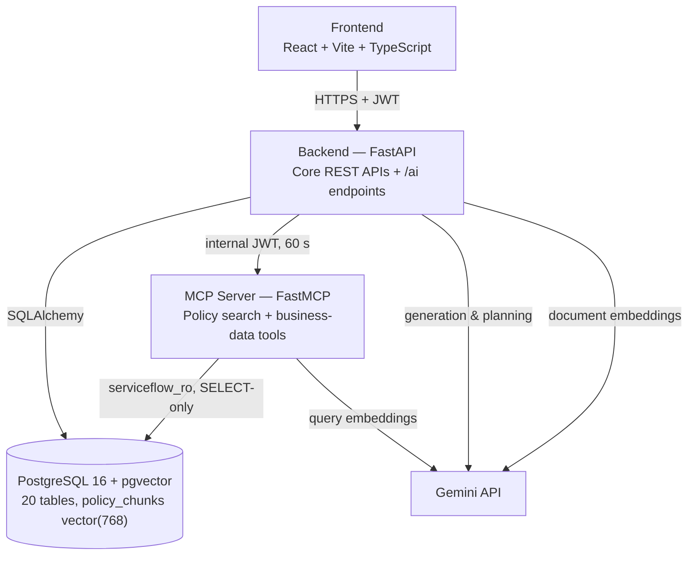

# ServiceFlow

**An AI-assisted service business management platform** — a marketplace that connects clients with local service providers (cleaning, maintenance, repairs and similar field services), and runs the whole engagement end to end: service requests, quotations, scheduled jobs, invoices and payments, and an AI assistant (**Flow AI**) that answers questions from provider policy documents and live business data.


---

## Table of contents

- [Overview](#overview)
- [Features](#features)
- [Architecture](#architecture)
- [Tech stack](#tech-stack)
- [Repository structure](#repository-structure)
- [Getting started](#getting-started)
- [Configuration](#configuration)
- [Flow AI](#flow-ai)
- [API documentation](#api-documentation)
- [Testing](#testing)
- [Design system](#design-system)
- [Team](#team)
- [Deployment](#deployment)
- [Project status](#project-status)

---

## Overview

ServiceFlow serves three kinds of users:

| Role | What they do |
| --- | --- |
| **Client** | Browses providers, submits service requests, reviews quotations, tracks jobs, pays invoices, rates completed work, raises disputes |
| **Provider** (individual or company) | Receives and quotes requests, assigns employees, schedules and completes jobs, manages services, working hours, service areas and policy documents |
| **System admin** | Approves or suspends provider accounts, manages the global service catalogue, oversees disputes |

Providers join through a two-step trust flow — email verification, then admin approval — before they can trade on the platform. Every provider's data is strictly tenant-isolated: no account can read or act on another provider's requests, jobs, invoices or documents.

## Features

- **Accounts & roles** — JWT authentication for clients, individual providers, company managers, company employees and admins; email verification; admin approval queue for new providers; forced first-login password change for employees.
- **Marketplace** — public provider directory and profiles with services, service areas, working hours, ratings and public policy documents.
- **Service requests** — clients submit requests with location, preferred date, photos and a message thread with the provider.
- **Quotations** — itemised quotes with optional down-payment, sent against a request; clients approve or decline.
- **Jobs** — employee assignment, schedule proposal/approval, on-site records and photos, completion workflow.
- **Invoices & payments** — invoices are generated automatically when a job completes; partial payments accumulate to PAID; manual payments are immutable; PDF invoices.
- **Employees & skills** — company teams with per-employee skill grants.
- **Working hours & service areas** — per-provider weekly hours and coverage areas.
- **Notifications** — in-app notifications for the platform's business events (requests, quotations, scheduling, payments, disputes and more).
- **Disputes & ratings** — clients can rate completed jobs (1–5) and open disputes on completed jobs; dispute closure is final.
- **Policy management** — providers upload policy PDFs; documents are chunked, embedded and stored for retrieval, with one active policy per type.
- **Flow AI** — a provider-facing AI assistant over policy documents and business data (see [Flow AI](#flow-ai)).

## Architecture

ServiceFlow runs as three cooperating services plus two Google APIs:



**Security model**

- End-user requests carry the user's own JWT; role checks run on every route, and provider scope is always derived from the authenticated token — never from client-supplied IDs.
- The backend calls the MCP server with a short-lived (60 s) internal JWT signed with `MCP_SIGNING_KEY`; the provider scope is injected into that token **server-side**, so the AI can only ever see the calling provider's data.
- The MCP server reads the database as **`serviceflow_ro`**, a login role with `SELECT` on six allow-listed tables only (`policies`, `policy_chunks`, `service_requests`, `quotations`, `jobs`, `invoices`) — no writes, no access to users or credentials.
- AI answers are **citation-validated**: a document answer must cite chunks that were actually retrieved, and a data answer may only cite record IDs present in the tool result. Anything else is replaced with an honest "insufficient evidence" response.

## Tech stack

| Layer | Technology |
| --- | --- |
| Frontend | React, Vite, TypeScript, Tailwind CSS |
| Backend | FastAPI (Python 3.12), SQLAlchemy, Alembic migrations, Pydantic settings |
| Database | PostgreSQL 16 with the pgvector extension |
| AI services | Separate FastMCP server (Python), reached over HTTP with internal JWTs |
| LLM | Google Gemini — generation/planning model configurable via `GEMINI_MODEL` (verified live with `gemini-3.5-flash-lite`) |
| Embeddings | Google `gemini-embedding-001`, 768 dimensions (Matryoshka), pinned — see [Flow AI](#flow-ai) |
| PDF processing | PyMuPDF (extraction/chunking), ReportLab (invoice PDFs) |
| Email | Gmail SMTP (verification and password-reset links) |
| Packaging | Docker Compose (database, backend, MCP server) |

## Repository structure

```text
ServiceFlow/
├── frontend/          React + Vite + TypeScript client (public, client,
│                      provider and admin interfaces)
├── backend/           FastAPI application
│   ├── app/           API routes, models, schemas, services, AI modules
│   ├── alembic/       Database migrations
│   ├── tests/         Pytest suite
│   ├── Dockerfile.ai  Backend image (python:3.12-slim)
│   └── .env.example   Backend environment template
├── mcp_server/        FastMCP server: policy search + business-data tools
│   └── Dockerfile     MCP image (python:3.12-slim)
├── docker/            docker-compose.yml and the read-only-role SQL
└── docs/              Design spec, structure and API/database notes
```

## Getting started

The supported way to run the full system is the Docker Compose stack (database + MCP + backend).

### Prerequisites

- Docker Desktop (or Docker Engine + Compose)
- A Google Gemini API key (for Flow AI generation and embeddings)
- Node.js LTS (only for running the frontend)

### 1. Clone

```bash
git clone https://github.com/amiztp/ServiceFlow.git
cd ServiceFlow
```

### 2. Configure the backend environment

```bash
cp backend/.env.example backend/.env
```

Edit `backend/.env` and set at least: `JWT_SECRET_KEY`, `GEMINI_API_KEY`, `GEMINI_MODEL`, and the Gmail SMTP values if you want verification emails to send. (Database values in this file are overridden by Compose for the container stack.)

### 3. Configure the Docker environment

Create `docker/.env`:

```env
POSTGRES_DB=serviceflow
POSTGRES_USER=serviceflow
POSTGRES_PASSWORD=<choose-a-password>
MCP_DB_PASSWORD=<choose-a-password-for-the-read-only-role>
MCP_SIGNING_KEY=<long-random-secret, at least 32 characters>
GEMINI_API_KEY=<your-gemini-api-key>
```

> ⚠️ `GEMINI_API_KEY` must be present **and non-empty** in `docker/.env` — the MCP service receives its key from here (the backend reads its own copy from `backend/.env`). A missing or blank value fails silently and surfaces only as Flow AI "unavailable" errors.

### 4. Start the database and create the read-only role

```bash
docker compose --env-file docker/.env -f docker/docker-compose.yml up -d db
```

Then run `docker/create-readonly-role.sql` once against the database (it reads the role password from the `MCP_DB_PASSWORD` environment variable) to create the `serviceflow_ro` login the MCP server uses.

### 5. Start the stack

```bash
docker compose --profile ai --env-file docker/.env -f docker/docker-compose.yml up -d --build backend
```

This starts `serviceflow-db`, the MCP server (internal only, no published port) and the backend on port **8000**. Give the backend \~30 seconds on first start, then verify:

```bash
curl http://localhost:8000/health
# {"status":"ok"}
```

Interactive API documentation (Swagger UI) is at **http://localhost:8000/docs**.

### 6. Demo accounts (optional)

```bash
python backend/setup_fixtures.py
```

Creates fixture accounts — a system admin, two company managers and a client — for local testing.

### 7. Frontend

```bash
cd frontend
npm install
```

Create `frontend/.env` with `VITE_API_BASE_URL=http://localhost:8000`, then:

```bash
npm run dev
```

The app runs at **http://localhost:5173**.

## Configuration

**Backend (`backend/.env`)** — `DB_HOST`, `DB_PORT`, `DB_NAME`, `DB_USER`, `DB_PASSWORD` · `JWT_SECRET_KEY`, `JWT_ALGORITHM`, `ACCESS_TOKEN_EXPIRE_MINUTES` · `GEMINI_API_KEY`, `GEMINI_MODEL`, `GEMINI_EMBEDDING_MODEL` · `GMAIL_SMTP_USER`, `GMAIL_SMTP_APP_PASSWORD` · `FRONTEND_VERIFY_EMAIL_URL`, `FRONTEND_RESET_PASSWORD_URL`

**MCP server (environment)** — `MCP_DB_HOST`, `MCP_DB_PORT`, `MCP_DB_NAME`, `MCP_DB_PASSWORD` · `MCP_SIGNING_KEY` (must match the backend's) · `GEMINI_API_KEY`, `GEMINI_EMBEDDING_MODEL`

**Compose (`docker/.env`)** — `POSTGRES_DB`, `POSTGRES_USER`, `POSTGRES_PASSWORD`, `MCP_DB_PASSWORD`, `MCP_SIGNING_KEY`, `GEMINI_API_KEY`

## Flow AI

Flow AI is the provider-facing assistant, exposed as two endpoints on the backend (provider roles only — clients receive 403):

| Endpoint | What it does |
| --- | --- |
| `POST /ai/ask-docs` | Answers questions from the provider's own **ACTIVE + PUBLIC** policy documents, with citations (document, page, chunk) |
| `POST /ai/ask-data` | Answers questions about the provider's business data — service requests, quotations, jobs, unpaid invoices — over a rolling window (default 90 days, max 366) |

**How ask-docs works.** The question is embedded with `gemini-embedding-001` and run through the MCP server's hybrid search (pgvector cosine + full-text keyword, fused) over the provider's policy chunks. Gemini generates an answer from the retrieved chunks only; citations are validated server-side. If the policies don't contain the answer, the API returns `insufficient_evidence` — it does not guess.

**How ask-data works.** A Gemini *planning* call converts the question into a structured plan naming one of four fixed tools (`get_requests`, `get_quotations`, `get_jobs`, `get_unpaid_invoices`) with an optional status and date range. The MCP server executes that tool provider-scoped, and a second Gemini call phrases the answer. **No SQL is generated anywhere in this path.**

**Embeddings.** Policy chunks are embedded at upload time with `gemini-embedding-001` at **768 dimensions**, using `RETRIEVAL_DOCUMENT` for chunks and `RETRIEVAL_QUERY` for questions; vectors are L2-normalised and stored in `policy_chunks.embedding` (`vector(768)`). The model name is pinned in code and via `GEMINI_EMBEDDING_MODEL` — documents and queries must always use the same model, and changing the model requires re-embedding existing chunks (an Alembic migration does exactly this).

## API documentation

- Live Swagger UI: `/docs` on the running backend.
- The backend exposes route groups for auth, providers, services, requests, quotations, jobs, invoices, payments, employees, working hours, service areas, notifications, disputes, ratings, policies, admin and AI — see `backend/app/api/routes/`.
- Additional notes live under `docs/` (`docs/api`, `docs/database`).

## Testing

Backend tests (pytest):

```bash
cd backend
python -m pytest -q
```

Beyond unit tests, every backend module was acceptance-tested live against a real database before sign-off — happy paths plus role/tenant isolation (403/404), validation (422/413) and state-rule conflicts (409) — and Flow AI was accepted end-to-end on the Docker stack, including citation verification against the stored chunks and honest-zero behaviour for providers with no data.

## Design system

The UI follows **Hi-Vis Graphite**: graphite surfaces (`#22262B` / `#2E3238`), a signal-yellow accent (`#F2C230`), Sora for headings and Inter for body text, "work-order docket" styling with punched-tag status badges. The full specification is in [`docs/serviceflow-design-spec.md`](docs/serviceflow-design-spec.md).

## Team

A four-member university team project:

| Member | Ownership |
| --- | --- |
| **Member 1 — Yasiru** | Shared design system, public and client frontend |
| **Member 2 — Amishka** | Provider, employee and admin frontend; Flow AI panel |
| **Member 3 — Isuru** | Backend core: APIs, database, authentication |
| **Member 4 --- Nadeeshan** | AI workstream: MCP server, Flow AI integration, embeddings, Docker |

## Deployment

**Current state:** the system runs as the Docker Compose stack described above.

**Planned production topology** (in preparation): the backend and MCP server as two services on Render, PostgreSQL/pgvector on Neon, policy PDFs in Cloudflare R2 (private bucket), and the frontend as a static site on Cloudflare Pages. Embeddings and generation are hosted Gemini APIs, so no service loads a local model — the design fits free-tier instance limits.

## Project status

- ✅ Backend APIs — complete and acceptance-tested (auth, marketplace, requests, quotations, jobs, invoices/payments, employees, working hours, service areas, notifications, disputes + ratings, policies, admin)
- ✅ Flow AI (ask-docs + ask-data) — implemented and accepted end-to-end, including the migration from local MiniLM embeddings to hosted Gemini embeddings
- ✅ Backend consolidated on `main` (PR #9)
- 🚧 Frontend — provider/admin and client interfaces built; live-API wiring of the remaining pages in progress
- 🚧 Cloud deployment — architecture decided; environment setup in preparation

---

*ServiceFlow is a university team project, built for learning and demonstration.*
